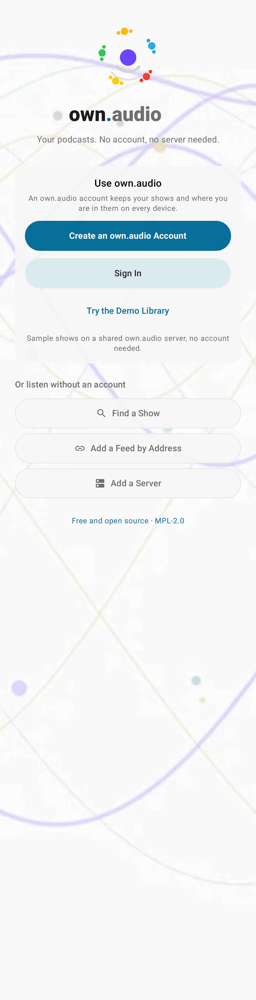

# Getting started
{: .no_toc }

1. TOC
{:toc}

## The first screen

Until you follow a show or add a server, the app opens on a welcome screen.

{: width="300"}

At the top, **Use own.audio**: an own.audio account keeps your shows, and where you are in
them, on every device.

- **Create an own.audio Account**: fill in **Your Name**, **Email** and a **Password** of at
  least 12 characters (a few words are fine), then **Create Account**. The app signs in to the
  new account straight away. own.audio emails you a link to confirm the address.
- **Sign In**: for an account you already have, with your **Email** and **Password**.
- **Try the Demo Library** signs in to a shared own.audio server with sample shows, with no
  account needed.

In the Google Play build, both pages also have **Continue with Google**, which makes the
account on first use. The F-Droid build has no Google sign-in; use your email and password.

Under **Or listen without an account**:

- **Find a Show** opens [Discover](discover.md): browse categories or search by name.
- **Add a Feed by Address** follows a show by its RSS feed address.
- **Add a Server** adds an own.audio, Audiobookshelf or gPodder sync account.

None of them is required before the others. Most people start with **Find a Show**.

Once something is there, the app opens on its four tabs: **New Episodes**, **Shows**,
**Downloads** and **Discover**. On a tablet the tabs are a rail along the side.

## Follow a show by searching

1. Tap **Find a Show** (or the **Discover** tab later on).
2. Type the show's name in the search field, **Shows and Episodes**.
3. Tap the show in the results, then tap **Follow**.

After following, the button changes to **Following — Open the Show**. The show's newest
episodes appear in New Episodes from then on.

## Follow a show by its feed address

Every podcast publishes an RSS feed. If you have its address (often a link called "RSS" on the
show's website):

1. Tap **Add a Feed by Address** on the welcome screen, **Add by Address** at the top of
   Discover, or **+** (**Add a Show**) on the Shows tab.
2. Type or paste the address under **Feed Address**, for example `https://example.com/feed.xml`.
3. Tap **Follow**.

You can leave out `https://`; the app adds it. Addresses that start with `feed://`,
`podcast://` or `pcast://` work too. If the address isn't a feed, the app says
**That address is not a podcast feed.**

### Links from web pages and other apps

When you tap a `feed://`, `podcast://` or `pcast://` link in a browser or another app,
own.podcast opens with **Add a Show** already filled in. Check the address and tap **Follow**.

### Where the show is followed

With no server, every show is followed on **This Device**. If you have added a server that
takes new shows (own.audio, or an Audiobookshelf account that may upload), a **Follow On**
choice appears, so you can pick this device or that server. See [Servers and sync](servers.md).

## Add a server

You only need this if you run a server or have an account on one.

1. Tap **Add a Server** on the welcome screen, or in [Settings](settings.md) later.
2. Leave **Kind** on **Automatic**, or pick **own.audio**, **Audiobookshelf** or
   **gPodder sync**. With **Automatic** the app finds out which one answers at the address.
3. Type the server's address, your **Email** or **User Name**, and your **Password**.
4. Tap **Add**.

For own.audio's hosted service, type just `own.audio` as the address. A home server's address
can be typed without `https://`; the app tries https first and then http. In the Google Play
build, **Continue with Google** appears under the form when the own.audio server accepts it.
If your account has two-factor sign-in, the app then asks for the code from your authenticator
app, or one of your recovery codes.

[Servers and sync](servers.md) explains what each kind of server adds.

## Try the public demo

To see what a server adds without an account, tap **Try the Demo Library** on the welcome
screen. It signs in to a shared own.audio server with sample shows. You can remove it again in
[Settings](settings.md) at any time.
