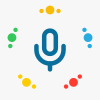
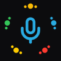
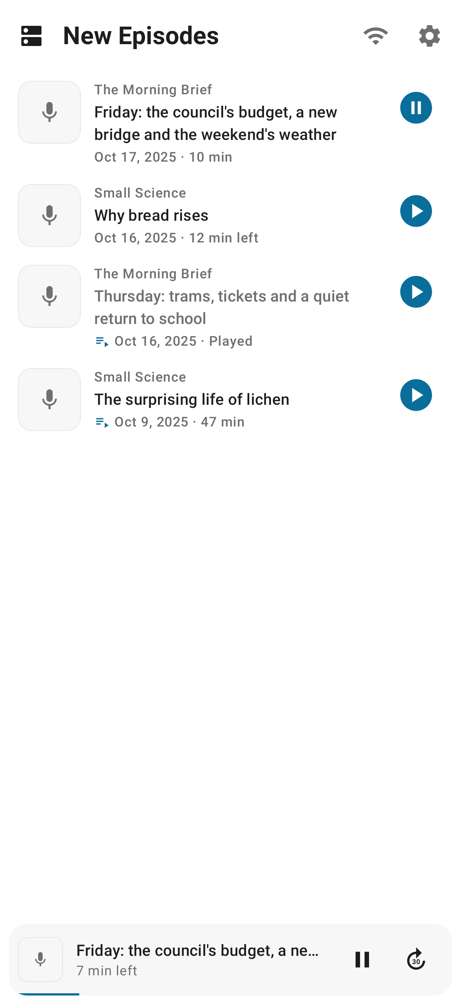
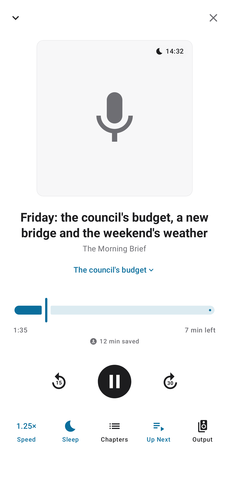
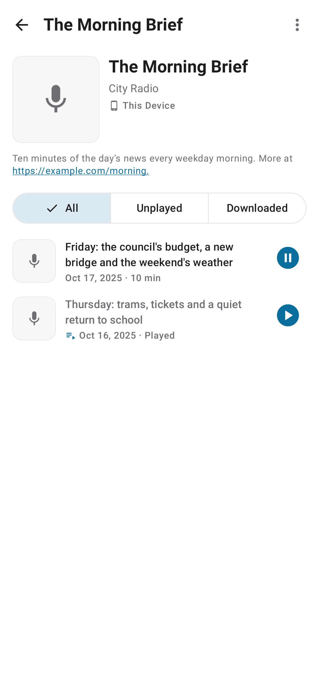
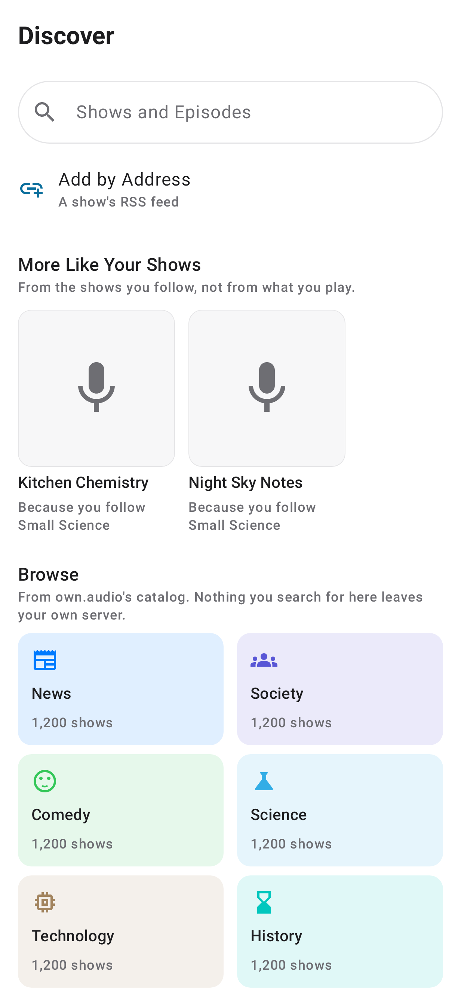

# own.audio Podcasts

own.audio Podcasts is a podcast player for Android phones and tablets. On the home screen it is
called **own.podcast**. It is free and open source, and runs on Android 9 and later.

You need no account and no server. Find a show by name or paste its feed address, and listen.
Everything you follow, every position and every download stays on your phone.

If you run a server, or use one, you can add it as well:

- **own.audio**: your family's podcast library, with positions on every device.
- **Audiobookshelf**: the podcast libraries of your Audiobookshelf server.
- **gPodder sync** services such as podfetch and gpodder.net (an own.audio server speaks it
  too): the shows on your phone and your positions are kept in step with your other players.

You can add several servers at once. The app only shows what each one can do, so a button a
server doesn't support isn't there. [Servers and sync](servers.md) has the details.

{: width="200"}
{: width="200"}
{: width="200"}
{: width="200"}

## Getting the app

The app is not yet on Google Play. An F-Droid build is coming too. Both builds are the same
app; the F-Droid one has no Google code, so it has no **Continue with Google**.
**Continue with Apple** is in both.

## What's in this guide

- [Getting started](getting-started.md): the first screen, following your first show, adding a
  server, the public demo.
- [New Episodes](new-episodes.md): the first tab, and what you can do with an episode in a list.
- [An episode's page](episode.md): notes, chapters, Play Next and Play Later, downloading.
- [Shows](shows.md): your shows, a show's page, and each show's own settings.
- [Discover and search](discover.md): categories, search, similar shows, following by address.
- [The player](player.md): speed, skip buttons, chapters, the sleep timer, where the sound plays.
- [Up Next](up-next.md): your queue.
- [Downloads and Offline Mode](downloads.md): downloads, rules per show, storage, mobile data.
- [Servers and sync](servers.md): what each kind of server adds, and the server page.
- [own.audio extras](own-audio.md): the family, devices, listening time, summaries.
- [Settings](settings.md): every setting and its default.
- [Android Auto, the widgets and the notification](system.md)
- [Privacy](privacy.md)
- [Troubleshooting](troubleshooting.md)

## Help and feedback

- Privacy policy: [PRIVACY.md](https://github.com/own-audio/podcast-android/blob/main/PRIVACY.md)
- Something not working, or a question: [open an issue](https://github.com/own-audio/podcast-android/issues),
  or write to hello@own.audio. See [Troubleshooting](troubleshooting.md) for the log to attach.
- The source code: [github.com/own-audio/podcast-android](https://github.com/own-audio/podcast-android)
  (MPL-2.0).
