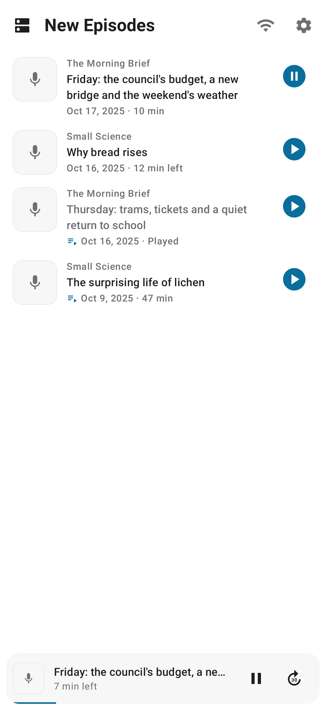

# New Episodes
{: .no_toc }

1. TOC
{:toc}

The first tab. It lists the unplayed episodes of the shows you follow that came out since you
followed them, from every source, newest first.

{: width="300"}

Each row shows the show, the episode's title, its date and its length (or the time left, or
**Played**). A small arrow means the episode is downloaded, a ring that it is downloading, and
the Up Next symbol that it is in [Up Next](up-next.md). Tap the row to open the
[episode's page](episode.md), or the round play button to play it right away. Tap the play
button of the episode that is playing to pause it.

An episode leaves New Episodes when you finish it, mark it played, or dismiss it.

Pull the list down to check every feed and server for new episodes. The app also checks by
itself when it opens, and about every hour in the background (see
[Android Auto, the widgets and the notification](system.md#in-the-background)).

If you don't want a show's new episodes here, turn off **Show in New Episodes** in its
[Show Settings](shows.md#show-settings).

## Swipes

- Swipe right: **Played** (or **Unplayed** if it is already played).
- Swipe left: **Dismiss**, which takes the episode out of New Episodes without marking it
  played.

## Touch and hold

Touch and hold an episode for its menu:

| Item | What it does |
|---|---|
| **Play** | Plays it now. |
| **Mark as Played** / **Mark as Unplayed** | Marks it, without playing. |
| **Play Next** | Puts it first in Up Next. |
| **Play Later** | Puts it last in Up Next. |
| **Remove from Up Next** | Shown instead of the two above when it is already queued. |
| **Download** | Downloads it to the phone. |
| **Cancel Download** | While it downloads. |
| **Remove Download** | Deletes the downloaded file; the episode stays. |
| **Try the Download Again** | After a failed download. |
| **Remove from New Episodes** | The same as the Dismiss swipe. |

The same swipe right and menu (without the New Episodes items) work on a show's page and in
search results too.

## The top bar

- The **Wi-Fi** button turns [Offline Mode](downloads.md#offline-mode) on and off. While it is
  on, or when there is no network, a line at the top says **Offline Mode is on** or
  **No network**, and episodes that are not on the phone are greyed out.
- The gear opens [Settings](settings.md).
- With more than one source, the server button on the left chooses what New Episodes and Shows
  show: **All Sources**, **This Device**, or one server (an Audiobookshelf server with several
  podcast libraries is listed with all of them, then once per library). The choice is remembered.

## When it is empty

**No New Episodes** means nothing new has come out since you followed your shows, or you have
listened to all of it. Follow more shows in [Discover](discover.md).
