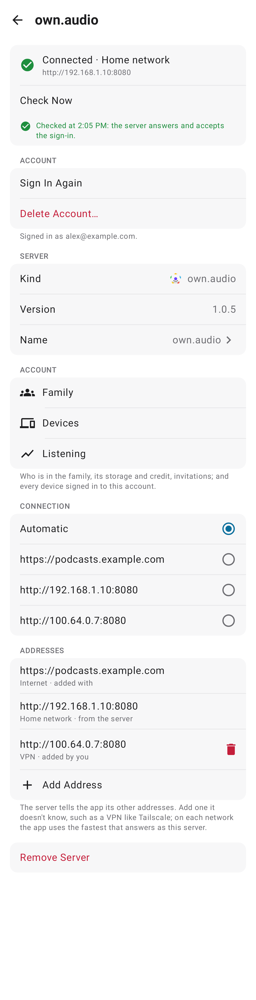

# Servers and sync
{: .no_toc }

1. TOC
{:toc}

The app is complete with feeds alone. A server adds shows of its own, positions that follow you
between devices, and, depending on the server, more. You can add as many as you like; they are
listed in [Settings](settings.md) under **Servers**, own.audio first.

To add one, see [Getting started](getting-started.md#add-a-server).

## What each source does

| | This Device (feeds) | own.audio | Audiobookshelf | gPodder sync |
|---|---|---|---|---|
| Where the shows come from | Feeds you follow | The shows your family follows on the server | The server's podcast libraries | The shows on this phone, kept in step with the account |
| Follow a new show from the app | Yes | Yes | Yes, if your account may upload | Yes: follow it on this phone, and the account gets it |
| Unfollow from the app | Yes | Shows you added; the family's admin also shared ones | No | Yes, on this phone |
| Positions and played marks on other devices | No, they stay on this phone | Yes | Yes, for the episodes the server holds | Yes |
| Episodes kept on the server | No | Yes | Yes | No |
| Family, devices, listening time | | Yes, see [own.audio extras](own-audio.md) | | |
| Catalog for Discover | | Where the server has one | | |
| Episode summaries and questions | | Where the server offers them | | |
| Sign in with Google (Google Play build) | | Where the server accepts it | | |

Notes:

- **Audiobookshelf**: a show's episodes are the ones the server holds. For a show with a feed,
  the feed's other episodes are listed too and play from the publisher; their positions stay on
  this phone. Without upload permission, you can browse, play and sync positions, and the add
  buttons don't offer the server. An account with no podcast library can't be added.
- **gPodder sync** (podfetch, gpodder.net, an own.audio server): the account has no shows of
  its own in the app. It keeps your phone's shows, positions and played marks in step with the
  other players on the same account; whichever device was listened to last wins. On podfetch,
  the admin account can't sync: add a separate user there and sign in with it.
- When several servers are added, the source switch at the top of
  [New Episodes](new-episodes.md#the-top-bar) shows one or all of them.

## The server page

In **Settings**, tap a server. A colored dot on its icon in the list shows whether it answers:
green when it does, orange when no address answers, grey while it hasn't been checked yet.

{: width="300"}

### Status

The top line says **Connected** with the kind of network (**Home network**, **VPN** or
**Internet**) and the address in use, or **No address answers right now**. **Check Now** tries
again and says what it found: the server answers and accepts the sign-in, it refuses the
sign-in, or no address answers.

### Account

"Signed in as" your user name or email.

- **Sign In Again**: enter the password again, for example after you changed it, or when the
  page says **The server no longer accepts this sign-in.** If you signed up with Google, sign
  in the same way.
- **Delete Account…** (own.audio): see
  [own.audio extras](own-audio.md#deleting-your-account).

### Server

**Kind** (own.audio, Audiobookshelf, gPodder sync, or podfetch), the server's **Version** when
it reports one, and **Name**: tap the name to rename the server in the app.

### Libraries (Audiobookshelf)

A switch for each podcast library on the server. A library you turn off leaves New Episodes,
Shows and the source switch. With more than one library turned on, each is a choice of its own
in the switch.

### Sync (gPodder)

**Sync Now** syncs at once, and **Last Synced** says when it last did. The app also syncs on
every refresh.

### Family, Devices and Listening (own.audio)

Described in [own.audio extras](own-audio.md).

### Connection and addresses

A server can be known by several addresses: one on your home network, one over a VPN such as
Tailscale, a public one. On each network the app uses the fastest address that answers as
this server.

- **Connection**: **Automatic** (the default) or one fixed address.
- **Addresses**: every address with its network kind and where it came from
  (**added with**, **from the server**, **added by you**). **Add Address** adds one, for example
  `http://192.168.1.20:8080`. The bin next to an address you added removes it. An own.audio
  server tells the app its other addresses by itself.

### Remove Server

Asks first. For own.audio and Audiobookshelf, the server's shows leave this device; nothing
changes on the server. For a gPodder account, the shows on this device stay, and are no longer
kept in step.

## Live updates (own.audio)

While the app is open and online, it follows changes on each own.audio server, so a show
added on the server or a position from another device appears without pulling to refresh.
