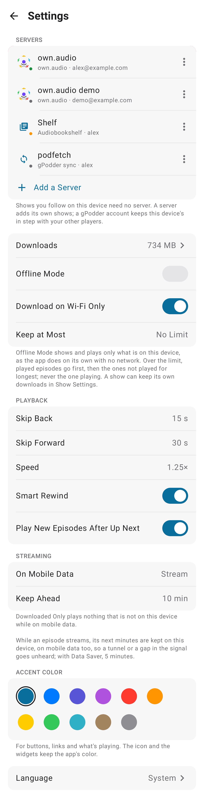

# Settings
{: .no_toc }

Open Settings with the gear at the top of [New Episodes](new-episodes.md). It is a page of its
own; the back arrow or Android's back gesture closes it. Changes take effect at once.

{: width="300"}

1. TOC
{:toc}

## Servers

Your servers, own.audio first, each with its kind and user name, and a dot for whether it
answers. Tap one for its [server page](servers.md#the-server-page); swipe one to the left to
remove it (the app asks first). **Add a Server** adds another. Shows you follow on this device
need no server.

## Downloads and Offline Mode

| Setting | Default | What it does |
|---|---|---|
| **Downloads** | | Opens the list of downloads; shows how much space they take. |
| **Offline Mode** | off | Shows and plays only what is on this device. See [Offline Mode](downloads.md#offline-mode). |
| **Download on Wi-Fi Only** | on | Downloads, yours and the shows' own, wait for Wi-Fi. |
| **Keep at Most** | **No Limit** | A limit for all downloads: 1, 2, 5 or 10 GB. Over it, played episodes go first, then the ones not played for longest; never the one playing. |

A show can also keep its own downloads; see [Show Settings](shows.md#show-settings).

## Playback

| Setting | Choices | Default | What it does |
|---|---|---|---|
| **Skip Back** | 5, 10, 15, 30, 45, 60, 90 s | 15 s | The skip back button, in the app, the notification and Android Auto. |
| **Skip Forward** | 5, 10, 15, 30, 45, 60, 90 s | 30 s | The skip forward button. |
| **Speed** | 0.75× to 2× | 1× | The speed episodes start at. A show can have its own. |
| **Smart Rewind** | on / off | on | After a pause, goes back a few seconds (3 s after a short pause, up to 30 s after an hour). |
| **Play New Episodes After Up Next** | on / off | on | When Up Next runs out, the newest new episode plays on. |

## Streaming

| Setting | Choices | Default | What it does |
|---|---|---|---|
| **On Mobile Data** | **Stream**, **Downloaded Only** | **Stream** | **Downloaded Only** plays nothing that isn't on this device while on mobile data. |
| **Keep Ahead** | 5, 10, 15 min | 10 min | While an episode streams, this much of what comes next is kept on this device, on mobile data too. With Data Saver on, 5 minutes. |

## Accent Color

The color of buttons, links and what's playing: **App Color** (the app's blue, the default),
Blue, Indigo, Purple, Pink, Red, Orange, Yellow, Green, Teal, Brown or Graphite. The icon and
the widget keep the app's color.

## Language

**System** (the default) follows your phone's language. You can also pick **English** or
**Čeština** for this app only.

## About

- **Version**: the app's version.
- **Source Code and Licence**: the code on GitHub (MPL-2.0).
- **Privacy**: the privacy policy.
- **Licences**: the software and pictures by others that the app uses, under their licences.
- **Logs**: what the app wrote to its log since it started. See
  [Troubleshooting](troubleshooting.md#the-log).
