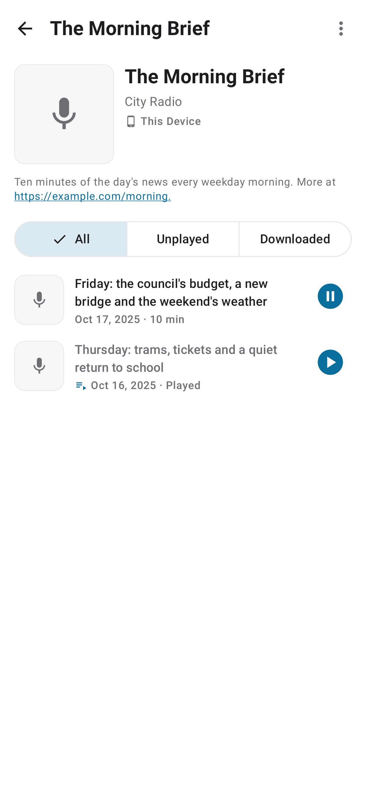

# Shows
{: .no_toc }

1. TOC
{:toc}

## The Shows tab

Every show you follow, as a grid of pictures. With more than one source, the shows are grouped
under the source they come from (**This Device**, or a server's name). A source that doesn't
answer says **Can't be reached right now**.

- **+** (**Add a Show**) follows a show by its [feed address](getting-started.md#follow-a-show-by-its-feed-address).
- **Sort**: **Title**, **New Episodes First** or **Recently Followed**. The app remembers your
  choice.
- Pull down to check for new episodes.

The source switch on [New Episodes](new-episodes.md#the-top-bar) also decides which sources
the Shows tab shows.

## A show's page

{: width="300"}

Tap a show to open it: the picture, the title, the author, the source, the show's description,
and its episodes, newest first. The choice above the episodes filters them: **All**,
**Unplayed** or **Downloaded**. Pull down to refresh just this show.

Where Discover uses an own.audio catalog, the bottom of the page has **Similar Shows**, a row
of shows like this one that you don't follow yet (see [Discover](discover.md)).

The **More** menu (three dots) at the top has:

| Item | What it does |
|---|---|
| **Show Settings** | This show's own settings, below. |
| **Website** | The show's website, when the feed gives one. |
| **Share Feed** | Shares the feed address through Android's share sheet. |
| **Share with the Family** | own.audio, for a show you added: the rest of your family gets it too. |
| **Unfollow** | Shows on this device or on an own.audio server. Asks first; the show's episodes, positions, downloads and Up Next entries are removed. On own.audio, a show the family shares leaves their library too. |

Shows from an Audiobookshelf server can't be unfollowed from the app; manage them on the
server, where removing a show removes it for everyone.

## Show Settings

Changes take effect when you tap **Done**; **Cancel** leaves them as they were.

| Setting | Choices | Default | What it does |
|---|---|---|---|
| **Show in New Episodes** | on / off | on | Off: the show's new episodes don't appear in New Episodes. |
| **Add New Episodes to Up Next** | on / off | off | New episodes go to the end of [Up Next](up-next.md) as they arrive. Only episodes that come out after you turn it on. |
| **Skip the Intro** | **Off**, 10, 15, 20, 30, 45, 60, 90, 120 s | **Off** | An episode you start from the beginning starts this many seconds in. |
| **Speed** | **As in Settings**, 0.75× to 2× | **As in Settings** | A speed of its own for this show. Otherwise episodes start at the speed in [Settings](settings.md#playback). |

Under **Downloads**:

| Setting | Choices | Default | What it does |
|---|---|---|---|
| **Download New Episodes** | **Off**, **Newest 1**, 3, 5, 10 | **Off** | Keeps the newest unplayed episodes downloaded, by themselves. Whether this waits for Wi-Fi is decided by **Download on Wi-Fi Only** in Settings. |
| **Delete When Played** | on / off | off | A downloaded episode of this show is deleted once you have played it. |
| **Keep at Most** | **No Limit**, 1, 3, 5, 10 **Episodes** | **No Limit** | No more than this many of the show's episodes on the phone; the oldest go first. |

The episode you are listening to is never deleted by these rules. Downloads that a rule starts
by itself wait until Wi-Fi (if you chose Wi-Fi only) and the battery allow.
